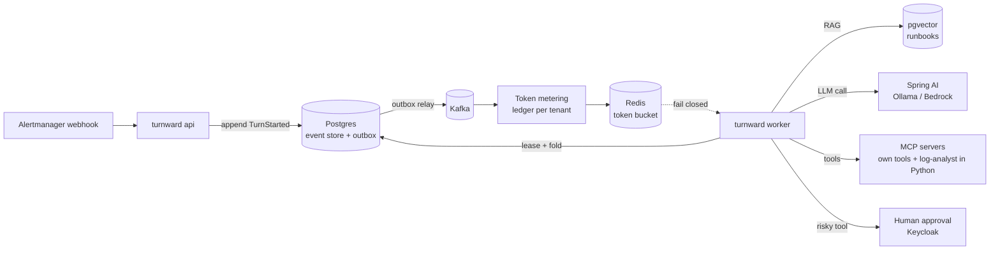

# turnward

**Durable control plane for AI agents: human approval, per-tool authorization and token budgets that survive a crash.**

[Português (Brasil)](README.pt-BR.md)

<!-- Badges are placeholders until CI exists (S1). -->

> **Status:** design phase. The code does not exist yet; this README describes what is being built and tracks progress in the roadmap below.

## The problem

An LLM agent that runs tools in production is a distributed system with an unreliable, expensive and non-deterministic component in the middle. Most agent frameworks keep the conversation in memory, so a crash in the middle of a turn loses the state, a retry can run a dangerous tool twice, and nobody knows how many tokens each customer is burning.

turnward is the durable layer underneath the agent:

- **Durable turns.** Every agent turn is an event stream in Postgres. A worker that crashes mid-turn is replaced, and the next one rebuilds the state from the events and continues.
- **Safe side effects.** Every external effect is preceded by a `*Started` event. On resume, read-only tools are retried with an idempotency key; a tool with side effects and no recorded outcome becomes `ToolOutcomeUnknown` and goes to a human. It is never blindly re-executed.
- **Human approval and per-tool authorization.** Risky tool calls wait for an approval, and who may approve which tool is decided per tenant from Keycloak claims.
- **Token budgets.** Every LLM call is metered per tenant. A Postgres ledger is the source of truth; Redis enforces the budget with a token bucket that fails closed.

## Use case: incident runbook agent

An alert starts a turn. The worker retrieves the matching runbook chunks from pgvector, asks the model what to do, calls tools over MCP, stops for human approval when a tool is risky, and finishes the turn with a resolution. Every step is an event, so the whole turn can be audited and resumed.

## Architecture

Hexagonal architecture in a Maven multi-module build. ArchUnit runs in CI to keep the dependency direction honest: the domain does not import Spring, and adapters do not know each other ([ADR-0001](docs/adr/0001-hexagonal-maven-multimodule-archunit.md)).

| Module | Responsibility |
|---|---|
| `turnward-domain` | `Turn` aggregate, events, state machine, tool policies. Plain Java |
| `turnward-application` | use cases and ports: `EventStore`, `LlmPort`, `ToolPort`, `RunbookSearch`, `BudgetPort`, `Outbox` |
| `turnward-adapter-web` | Alertmanager webhook, approval and query API, OAuth2 resource server |
| `turnward-adapter-persistence` | JDBC event store, outbox, worker lease, Flyway, `PgVectorStore` |
| `turnward-adapter-kafka` | outbox relay, metering consumer |
| `turnward-adapter-llm` | Spring AI (Ollama / Bedrock) with Resilience4j |
| `turnward-adapter-mcp-client` | MCP client for remote tools |
| `turnward-adapter-mcp-server` | MCP server exposing turnward's own tools |
| `turnward-adapter-redis` | budget token bucket |
| `turnward-app` | bootstrap; `api` and `worker` roles by profile |

Outside Maven: `agents/log-analyst/` (Python, Google ADK served over MCP), `infra/terraform/` (AWS), `deploy/compose/` (local stack), `docs/adr/` (decisions) and `runbooks/` (fictional runbooks).

## Stack

Java 25 (Temurin) · Spring Boot 4.1 · Spring AI · Postgres + pgvector · Kafka (KRaft) · Redis · Keycloak · MCP (Streamable HTTP) · Python + Google ADK · Resilience4j · OpenTelemetry, Prometheus, Grafana, Tempo · JUnit, Testcontainers, Pact, JaCoCo · Terraform on AWS (ECS Fargate, RDS, Bedrock) · GitHub Actions with OIDC.

## Roadmap

- [ ] **S0 Preparation:** versions confirmed, public repo with branch protection and signed commits, this README and ADR-0001.
- [ ] **S1 Durable core:** `mvn verify` green with ArchUnit; a webhook starts a turn that queries runbooks in pgvector, calls Ollama with fake tools and ends in `TurnCompleted`; CI with Testcontainers, a JaCoCo gate and a coverage badge.
- [ ] **S2 Kafka and resilience:** outbox publishes to Kafka without duplicates; token ledger per tenant; budget overflow returns 429; Resilience4j operator order tested; worker crash test passes.
- [ ] **S3 Security and MCP:** Keycloak with two tenants; cross-tenant approval is rejected with 403; MCP server validated with a real client; Python log-analyst as a remote MCP server; Pact contract between Java and Python in CI.
- [ ] **S4 Observability and AWS:** one trace from webhook to LLM to MCP to Python in Tempo; Grafana dashboard; Terraform up and down by workflow with OIDC; recorded demo.

## Running locally

Not available yet. The plan is a single `docker compose` stack in `deploy/compose/` (Postgres with pgvector, Kafka, Redis, Keycloak, Ollama and the observability stack) and `./mvnw verify` for the build.

## Decisions

Architecture decisions are recorded as ADRs in [`docs/adr/`](docs/adr/README.md).

## License

[Apache License 2.0](LICENSE).
