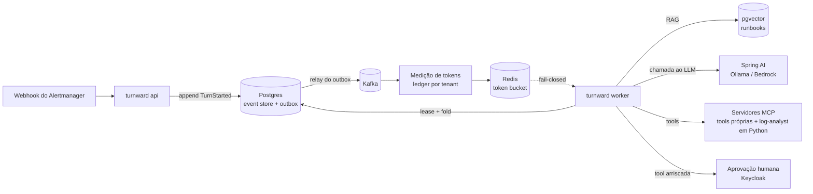

# turnward

**Control plane durável para agentes de IA: aprovação humana, autorização por tool e orçamento de tokens que sobrevivem a um crash.**

[English](README.md)

<!-- Os badges são provisórios até existir CI (S1). -->

> **Status:** fase de desenho. O código ainda não existe; este README descreve o que está sendo construído e acompanha o andamento no roadmap abaixo.

## O problema

Um agente de LLM que executa tools em produção é um sistema distribuído com um componente instável, caro e não determinístico no meio. A maioria dos frameworks de agente guarda a conversa em memória: um crash no meio do turno perde o estado, um retry pode executar duas vezes uma tool perigosa e ninguém sabe quantos tokens cada cliente está gastando.

O turnward é a camada durável por baixo do agente:

- **Turnos duráveis.** Cada turno do agente é um stream de eventos no Postgres. Se um worker cai no meio do turno, outro assume, reconstrói o estado a partir dos eventos e continua.
- **Efeitos colaterais seguros.** Todo efeito externo é precedido de um evento `*Started`. Na retomada, tool somente leitura é repetida com chave de idempotência; tool com efeito colateral e sem resultado registrado vira `ToolOutcomeUnknown` e vai para um humano. Nunca é reexecutada às cegas.
- **Aprovação humana e autorização por tool.** Chamada de tool arriscada espera aprovação, e quem pode aprovar cada tool é decidido por tenant, a partir das claims do Keycloak.
- **Orçamento de tokens.** Toda chamada ao LLM é medida por tenant. O ledger no Postgres é a fonte da verdade; o Redis aplica o orçamento com um token bucket fail-closed.

## Caso de uso: agente de runbook de incidentes

Um alerta inicia um turno. O worker busca os trechos de runbook correspondentes no pgvector, pergunta ao modelo o que fazer, chama tools por MCP, para e pede aprovação humana quando a tool é arriscada e encerra o turno com uma resolução. Cada passo é um evento, então o turno inteiro pode ser auditado e retomado.

## Arquitetura

Arquitetura hexagonal num build Maven multi-módulo. O ArchUnit roda no CI para garantir a direção das dependências: o domínio não importa Spring, e os adapters não se conhecem ([ADR-0001](docs/adr/0001-hexagonal-maven-multimodule-archunit.md), em inglês).

| Módulo | Responsabilidade |
|---|---|
| `turnward-domain` | agregado `Turn`, eventos, máquina de estados, políticas de tool. Java puro |
| `turnward-application` | casos de uso e portas: `EventStore`, `LlmPort`, `ToolPort`, `RunbookSearch`, `BudgetPort`, `Outbox` |
| `turnward-adapter-web` | webhook do Alertmanager, API de aprovação e consulta, resource server OAuth2 |
| `turnward-adapter-persistence` | event store JDBC, outbox, lease do worker, Flyway, `PgVectorStore` |
| `turnward-adapter-kafka` | relay do outbox, consumidor da medição |
| `turnward-adapter-llm` | Spring AI (Ollama / Bedrock) com Resilience4j |
| `turnward-adapter-mcp-client` | cliente MCP para tools remotas |
| `turnward-adapter-mcp-server` | servidor MCP com as tools do próprio turnward |
| `turnward-adapter-redis` | token bucket do orçamento |
| `turnward-app` | bootstrap; papéis `api` e `worker` por profile |

Fora do Maven: `agents/log-analyst/` (Python, Google ADK servido por MCP), `infra/terraform/` (AWS), `deploy/compose/` (stack local), `docs/adr/` (decisões) e `runbooks/` (runbooks fictícios).

## Stack

Java 25 (Temurin) · Spring Boot 4.1 · Spring AI · Postgres + pgvector · Kafka (KRaft) · Redis · Keycloak · MCP (Streamable HTTP) · Python + Google ADK · Resilience4j · OpenTelemetry, Prometheus, Grafana, Tempo · JUnit, Testcontainers, Pact, JaCoCo · Terraform na AWS (ECS Fargate, RDS, Bedrock) · GitHub Actions com OIDC.

## Roadmap

- [ ] **S0 Preparação:** versões confirmadas, repo público com branch protection e commits assinados, este README e o ADR-0001.
- [ ] **S1 Núcleo durável:** `mvn verify` verde com ArchUnit; um webhook inicia um turno que consulta runbooks no pgvector, chama o Ollama com tools fake e termina em `TurnCompleted`; CI com Testcontainers, gate do JaCoCo e badge de cobertura.
- [ ] **S2 Kafka e resiliência:** o outbox publica no Kafka sem duplicar; ledger de tokens por tenant; orçamento estourado devolve 429; ordem dos operadores do Resilience4j testada; o teste de crash do worker passa.
- [ ] **S3 Segurança e MCP:** Keycloak com dois tenants; aprovação entre tenants recusada com 403; servidor MCP validado num cliente real; log-analyst em Python como servidor MCP remoto; contrato Pact entre Java e Python no CI.
- [ ] **S4 Observabilidade e AWS:** um trace do webhook ao LLM, ao MCP e ao Python no Tempo; dashboard no Grafana; Terraform sobe e desce por workflow com OIDC; demo gravada.

## Rodando localmente

Ainda não disponível. O plano é uma única stack `docker compose` em `deploy/compose/` (Postgres com pgvector, Kafka, Redis, Keycloak, Ollama e a stack de observabilidade) e `./mvnw verify` para o build.

## Decisões

As decisões de arquitetura ficam registradas como ADRs, em inglês, em [`docs/adr/`](docs/adr/README.md).

## Licença

[Apache License 2.0](LICENSE).
