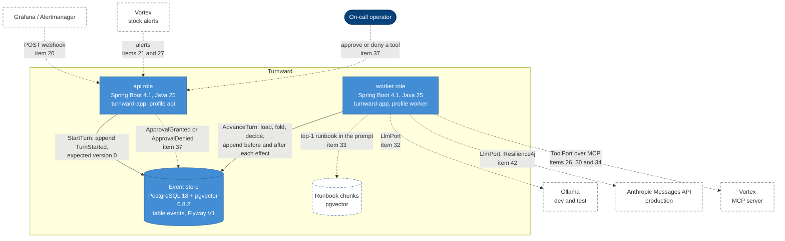

# Containers (C4 level 2)

*[Leia em português](containers.pt-BR.md)*

| Legend | |
|---|---|
| Blue | Built: code in `main`, tested |
| White, dashed border | Planned container or external system |
| Solid arrow | The code of that call exists and is tested |
| Dashed arrow | Planned, with the item of the portfolio program that brings it |
| Cylinder | Database |

The two roles are one Spring Boot application, `turnward-app`, started with the `api` or the `worker`
profile. No bean wires the use cases yet: the solid arrows are `StartTurn`, `AdvanceTurn` and
`JdbcEventStore`, tested against Postgres in Testcontainers and against in-memory fakes of `LlmPort` and
`ToolPort`. The worker poller that runs `AdvanceTurn` arrives with item 32, the web server of the `api`
role with item 20. The whole stack moves to the Vortex demo instance on AWS with item 45.

| Container | Path | Notes |
|---|---|---|
| api role | `turnward-app` (`application-api.yml`) | Webhook, approval and query endpoints come with `turnward-adapter-web` |
| worker role | `turnward-app` (`application-worker.yml`) | Never serves HTTP (`web-application-type: none`) |
| Event store | `turnward-adapter-persistence` | One stream per turn; `UNIQUE(stream_id, version)` decides concurrent writers ([ADR-0002](../adr/0002-event-sourcing-in-postgres.md)) |
| Runbook chunks | `turnward-adapter-persistence` | Planned, item 33: the Vortex runbooks embedded in pgvector |

## Inside the application

Hexagonal, one Maven module per part ([ADR-0001](../adr/0001-hexagonal-maven-multimodule-archunit.md)).
`ArchitectureTest` fails the build when the domain or the application depends on anything beyond the JDK
and themselves, or when one adapter depends on another.

| Module | State | What it holds |
|---|---|---|
| `turnward-domain` | Built | `Turn` (strict fold), `TurnEvent`, `TurnDecider` (pure, at most 8 model calls), `ToolPolicy` (`DANGEROUS` needs approval, only `READ_ONLY` is retried after a crash) |
| `turnward-application` | Built | `StartTurn`, `AdvanceTurn`, `ToolCatalog`; ports `EventStore`, `LlmPort`, `ToolPort` |
| `turnward-adapter-persistence` | Built | `JdbcEventStore`, `TurnEventSerializer`, `UuidV7`, Flyway `V1__create_events.sql` |
| `turnward-app` | Built, not wired | Bootstrap with the `api` and `worker` profiles; `ArchitectureTest` |
| `turnward-adapter-web` | Planned, items 20 and 37 | Alert webhook, approval API |
| `turnward-adapter-llm` | Planned, items 32 and 42 | Spring AI: Ollama, then the Anthropic API with Resilience4j |
| `turnward-adapter-mcp-client` | Planned, item 34 | `ToolPort` over the Vortex MCP tools, fail-closed catalog |
| `turnward-adapter-kafka`, `-redis`, `-mcp-server` | Shells, no dated item | Only a `package-info`; out of the diagrams until an item brings them |
