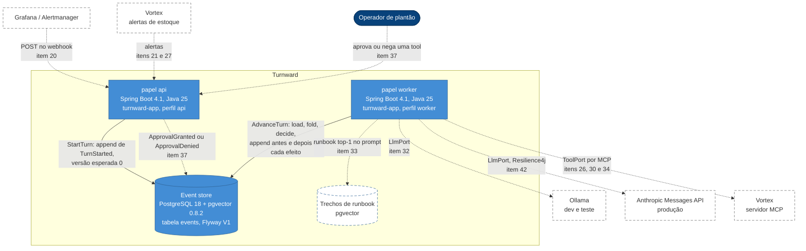

# Containers (C4 nível 2)

*[Read in English](containers.md)*

| Legenda | |
|---|---|
| Azul | Construído: código no `main`, testado |
| Branco, borda tracejada | Container ou sistema externo planejado |
| Seta contínua | O código dessa chamada existe e tem teste |
| Seta tracejada | Planejada, com o item do programa de portfólio que a traz |
| Cilindro | Banco de dados |

Os dois papéis são uma aplicação Spring Boot só, `turnward-app`, iniciada com o perfil `api` ou `worker`.
Nenhum bean liga os casos de uso ainda: as setas contínuas são `StartTurn`, `AdvanceTurn` e
`JdbcEventStore`, testados contra Postgres no Testcontainers e contra fakes em memória de `LlmPort` e
`ToolPort`. O poller do worker que roda o `AdvanceTurn` chega com o item 32, o servidor web do papel `api`
com o item 20. A pilha inteira vai para a instância da demo do Vortex na AWS com o item 45.

| Container | Caminho | Notas |
|---|---|---|
| papel api | `turnward-app` (`application-api.yml`) | Endpoints de webhook, aprovação e consulta chegam com o `turnward-adapter-web` |
| papel worker | `turnward-app` (`application-worker.yml`) | Nunca serve HTTP (`web-application-type: none`) |
| Event store | `turnward-adapter-persistence` | Um stream por turno; `UNIQUE(stream_id, version)` decide entre escritores concorrentes ([ADR-0002](../adr/0002-event-sourcing-in-postgres.md)) |
| Trechos de runbook | `turnward-adapter-persistence` | Planejado, item 33: os runbooks do Vortex com embedding no pgvector |

## Dentro da aplicação

Hexagonal, um módulo Maven por parte ([ADR-0001](../adr/0001-hexagonal-maven-multimodule-archunit.md)).
O `ArchitectureTest` quebra o build quando o domínio ou a aplicação dependem de algo além do JDK e deles
mesmos, ou quando um adapter depende de outro.

| Módulo | Estado | O que guarda |
|---|---|---|
| `turnward-domain` | Construído | `Turn` (fold estrito), `TurnEvent`, `TurnDecider` (puro, no máximo 8 chamadas ao modelo), `ToolPolicy` (`DANGEROUS` exige aprovação, só `READ_ONLY` é repetida depois de um crash) |
| `turnward-application` | Construído | `StartTurn`, `AdvanceTurn`, `ToolCatalog`; portas `EventStore`, `LlmPort`, `ToolPort` |
| `turnward-adapter-persistence` | Construído | `JdbcEventStore`, `TurnEventSerializer`, `UuidV7`, Flyway `V1__create_events.sql` |
| `turnward-app` | Construído, sem ligação | Bootstrap com os perfis `api` e `worker`; `ArchitectureTest` |
| `turnward-adapter-web` | Planejado, itens 20 e 37 | Webhook de alerta, API de aprovação |
| `turnward-adapter-llm` | Planejado, itens 32 e 42 | Spring AI: Ollama, depois a API da Anthropic com Resilience4j |
| `turnward-adapter-mcp-client` | Planejado, item 34 | `ToolPort` sobre as tools MCP do Vortex, catálogo fail-closed |
| `turnward-adapter-kafka`, `-redis`, `-mcp-server` | Cascas, sem item datado | Só um `package-info`; fora dos diagramas até um item trazê-los |
