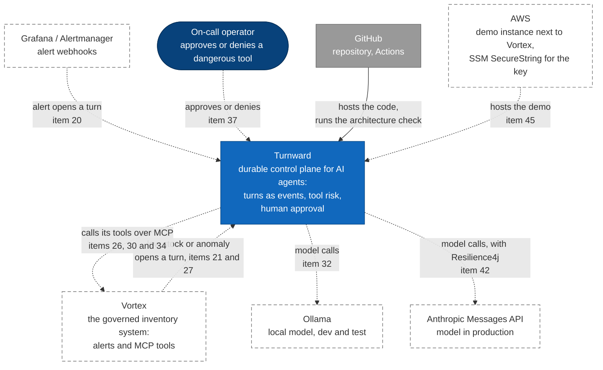

# Context (C4 level 1)

*[Leia em português](context.pt-BR.md)*

| Legend | |
|---|---|
| Dark blue, rounded | Person |
| Blue | The system described here |
| Grey | External system in use today |
| White, dashed border | External system planned; the arrow names its item in the portfolio program |
| Solid arrow | Exists today |
| Dashed arrow | Planned, with the item that brings it |

Today no external system talks to the running Turnward: the code is the domain, the use cases and the
event store, tested with Testcontainers and in-memory fakes. The Anthropic API answers only
`scripts/smoke-anthropic-api.sh`, which checks the production key outside the application.

- Ollama in dev and test, the Anthropic API in production, both behind Spring AI
  ([ADR-0011](../adr/0011-ollama-dev-anthropic-api-prod.md)).
- Vortex is a separate repository ([caiocv18/vortex](https://github.com/caiocv18/vortex)); Turnward reaches
  it only through its alerts and its MCP tools.
- The items are the dated blocks of the portfolio program. A planned element leaves this page, or turns
  solid, in the pull request that builds it.
