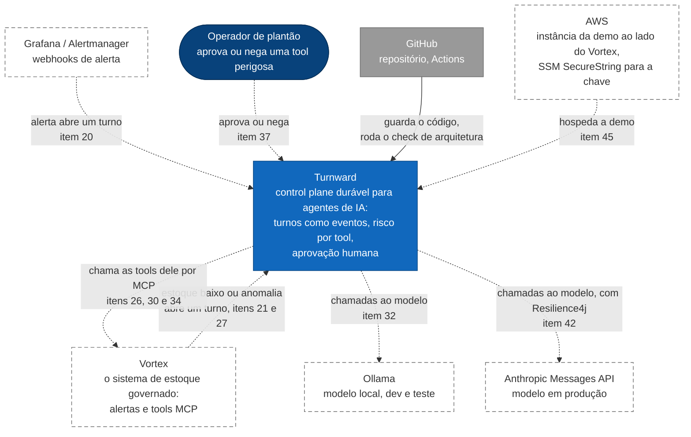

# Contexto (C4 nível 1)

*[Read in English](context.md)*

| Legenda | |
|---|---|
| Azul-escuro, arredondado | Pessoa |
| Azul | O sistema descrito aqui |
| Cinza | Sistema externo em uso hoje |
| Branco, borda tracejada | Sistema externo planejado; a seta diz o item do programa de portfólio |
| Seta contínua | Existe hoje |
| Seta tracejada | Planejada, com o item que a traz |

Hoje nenhum sistema externo conversa com o Turnward em execução: o código é o domínio, os casos de uso e o
event store, testados com Testcontainers e fakes em memória. A API da Anthropic só responde ao
`scripts/smoke-anthropic-api.sh`, que confere a chave de produção fora da aplicação.

- Ollama em dev e teste, a API da Anthropic em produção, as duas atrás do Spring AI
  ([ADR-0011](../adr/0011-ollama-dev-anthropic-api-prod.md)).
- O Vortex é outro repositório ([caiocv18/vortex](https://github.com/caiocv18/vortex)); o Turnward chega
  nele só pelos alertas e pelas tools MCP.
- Os itens são os blocos datados do programa de portfólio. Um elemento planejado sai desta página, ou fica
  contínuo, no pull request que o constrói.
