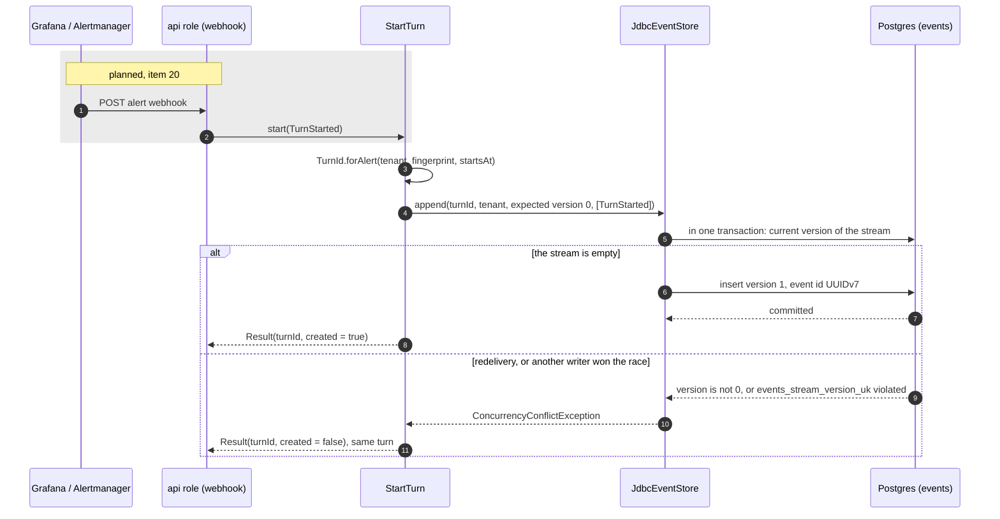
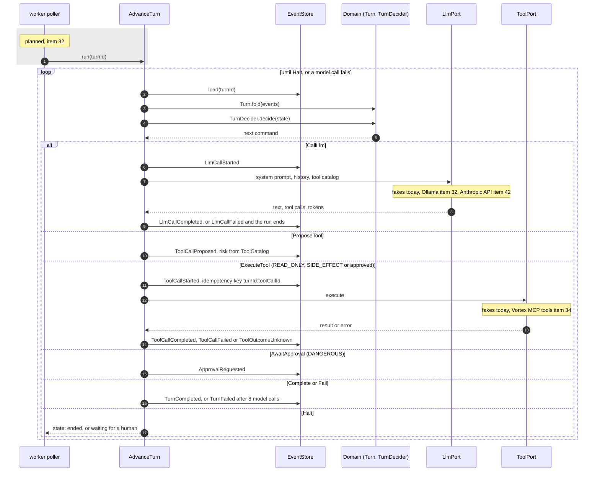

# Runtime flows

*[Leia em português](flows.pt-BR.md)*

Steps inside a grey box are planned; the note names the item of the portfolio program that brings them.
Everything else is code in `main`.

## Starting a turn

The turn id is derived from the alert, so a redelivered alert finds its stream taken and returns the same
turn: idempotent without a table of its own.

## Advancing a turn

- Every effect is preceded by its `*Started` event, and no transaction spans an effect. A crash leaves a
  stream the next run can read: a `READ_ONLY` tool that started is run again, any other becomes
  `ToolOutcomeUnknown` and waits for a human.
- A lost append race before an effect makes the run decide again from the new state. After an effect, the
  run reloads and appends the same outcome, so the effect is never repeated.
- A turn halted in `AWAITING_APPROVAL` moves again only when `ApprovalGranted`, `ApprovalDenied` or
  `ApprovalExpired` is appended. Today only the tests append them; the approval API is item 37.
