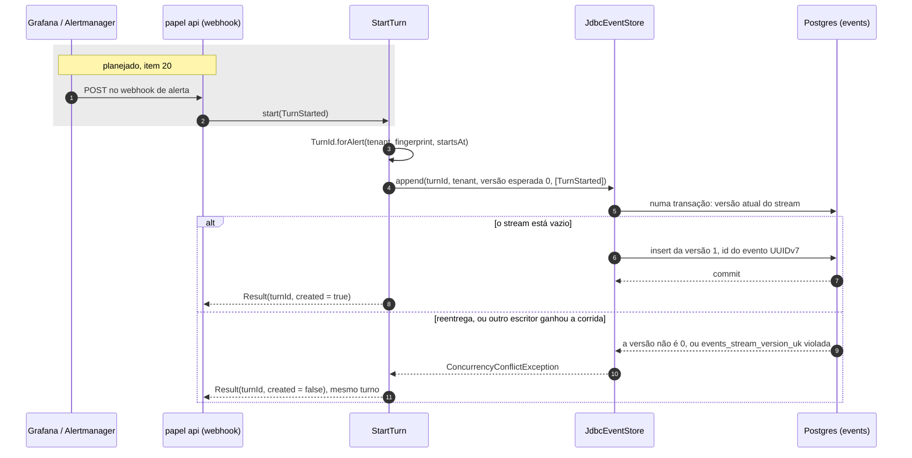
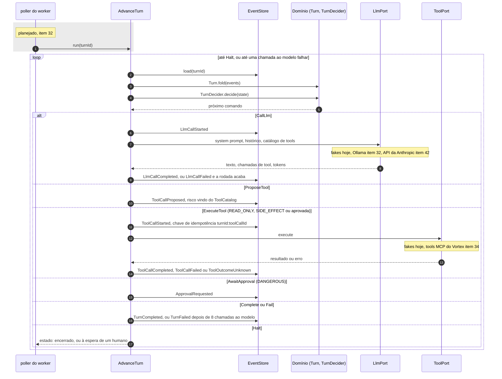

# Fluxos em execução

*[Read in English](flows.md)*

Os passos dentro de uma caixa cinza são planejados; a nota diz o item do programa de portfólio que os
traz. O resto é código no `main`.

## Início de um turno

O id do turno vem do alerta, então um alerta reentregue encontra o stream ocupado e devolve o mesmo turno:
idempotente sem tabela própria.

## Avanço de um turno

- Todo efeito vem depois do seu evento `*Started`, e nenhuma transação abrange um efeito. Um crash deixa um
  stream que a próxima rodada sabe ler: uma tool `READ_ONLY` que começou roda de novo, qualquer outra vira
  `ToolOutcomeUnknown` e espera um humano.
- Uma corrida de append perdida antes de um efeito faz a rodada decidir de novo a partir do estado novo.
  Depois de um efeito, a rodada recarrega e grava o mesmo resultado, então o efeito nunca se repete.
- Um turno parado em `AWAITING_APPROVAL` só volta a andar quando `ApprovalGranted`, `ApprovalDenied` ou
  `ApprovalExpired` é gravado. Hoje só os testes gravam esses eventos; a API de aprovação é o item 37.
